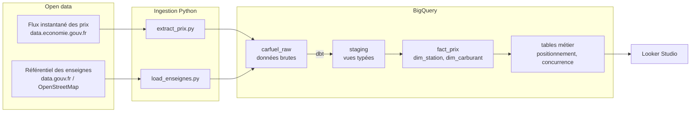
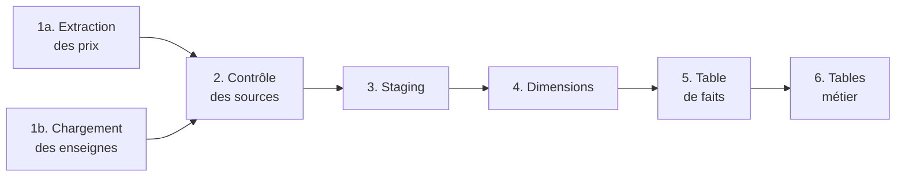
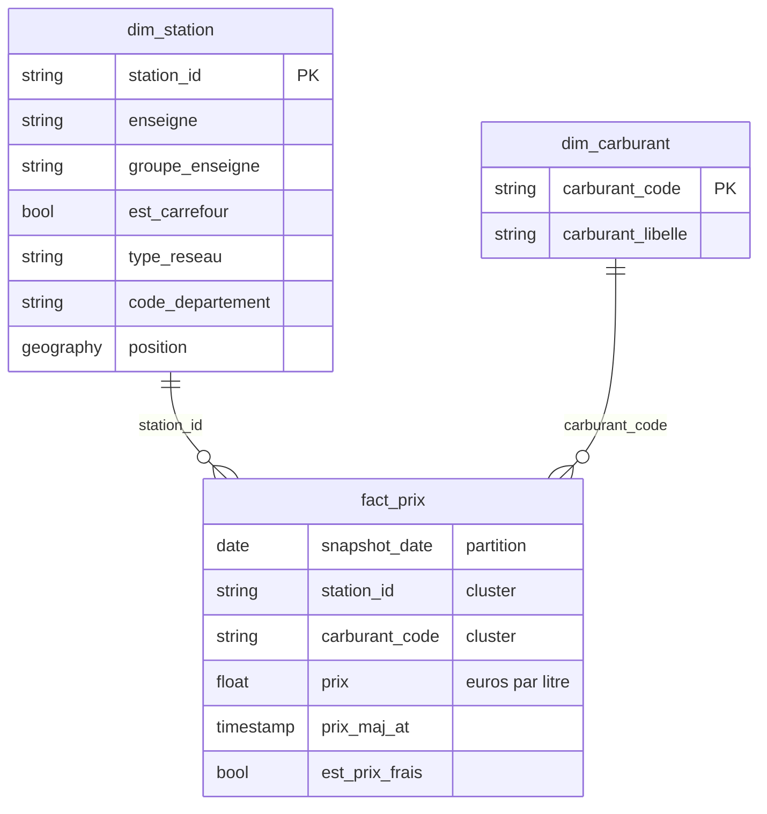

# Observatoire des prix des carburants

**Pipeline de données sur Google Cloud qui collecte chaque jour le prix des carburants des ~9 800 stations-service de France et mesure le positionnement prix des stations Carrefour face à leurs concurrents directs.**

[](https://github.com/BeaElie237/carfuel-prix-observatoire/actions/workflows/ci.yml)
[](https://github.com/BeaElie237/carfuel-prix-observatoire/actions/workflows/pipeline_quotidien.yml)


<p align="center">
  <a href="https://datastudio.google.com/reporting/e6d7d6ba-9dee-485e-93e0-c0d996bcf757">
    
  </a>
</p>

<!-- Pour afficher une capture du dashboard, ajoutez docs/dashboard.png puis retirez les marques de commentaire :
<p align="center">
  <a href="https://datastudio.google.com/reporting/e6d7d6ba-9dee-485e-93e0-c0d996bcf757">
    
  </a>
</p>
-->

---

## La question métier

> Dans sa zone de chalandise, une station Carrefour est-elle moins chère ou plus chère que ses concurrents, de combien, et où ?

Une équipe pricing carburants a besoin de suivre ce positionnement chaque jour, station par station et carburant par carburant. Ce projet construit la chaîne complète pour y répondre : collecte automatique, entrepôt de données modélisé, contrôles qualité et restitution visuelle.

Les données sont publiques : le ministère de l'Économie publie en continu les prix déclarés par toutes les stations de France.

## Premiers résultats

*Snapshot du 12 octobre 2026. Ces chiffres seront consolidés au fil de l'historique quotidien.*

| Carburant | Stations Carrefour comparées | Moins chère de sa zone (5 km) | Écart moyen vs concurrents |
| --- | ---: | ---: | ---: |
| Gazole | 788 | 19,2 % | **+2,0 cts/L** |
| SP95-E10 | 588 | 18,0 % | **+3,4 cts/L** |
| SP98 | 598 | 24,9 % | **+3,3 cts/L** |
| E85 | 155 | 49,7 % | **−4,4 cts/L** |

- **Sur les carburants principaux, les stations Carrefour sont en moyenne 2 à 3 centimes au-dessus de leurs concurrents situés à moins de 5 km.** Elles ne sont les moins chères de leur zone que dans environ un cas sur cinq.
- **L'E85 fait exception** : Carrefour y est moins cher dans la moitié des zones.
- **L'écart ne s'explique pas par le format de magasin.** Il est du même ordre pour les hypermarchés (+1,9 ct, 583 stations), les Carrefour Market (+2,4 cts, 167 stations) et les Carrefour Contact (+2,2 cts, 31 stations). Le positionnement est donc homogène sur le réseau.

Le détail par station, par département et par enseigne concurrente est dans le **[dashboard](https://datastudio.google.com/reporting/e6d7d6ba-9dee-485e-93e0-c0d996bcf757)**.

## Architecture



Le pipeline est orchestré par **GitHub Actions**, qui l'exécute chaque matin en 7 étapes. Chaque étape attend la précédente, et un test en échec arrête la chaîne avant que des données incorrectes n'atteignent le dashboard.



## Modèle de données

Modèle en étoile : une table de faits au grain **jour × station × carburant**, entourée de ses dimensions.



Deux tables métier sont construites à partir de ce modèle :

| Table | Grain | Ce qu'elle mesure |
| --- | --- | --- |
| `mart_concurrence_locale` | station Carrefour × carburant | Prix face aux concurrents dans un rayon de 5 km (`ST_DWITHIN`) : écart à la moyenne, écart au moins cher, rang dans la zone |
| `mart_positionnement_departement` | jour × département × carburant | Prix moyen Carrefour face aux concurrents, à la grande distribution et aux pétroliers |

## Choix techniques

| Choix | Pourquoi |
| --- | --- |
| **Couche brute en JSON** | Chaque enregistrement source est conservé tel quel. Si la source ajoute ou renomme un champ, l'ingestion ne casse pas : le typage se fait dans dbt. |
| **Ingestion idempotente** | Le snapshot du jour est écrit dans sa partition (`$AAAAMMJJ`). Relancer le pipeline remplace la journée sans créer de doublons. |
| **Relance automatique** | Le flux source est republié toutes les quelques minutes et peut être momentanément incomplet. Le script retélécharge jusqu'à obtenir un flux complet. |
| **Partitionnement et clustering** | `fact_prix` est partitionnée par date et clusterisée par carburant et station : une requête sur une période ne lit que les partitions utiles. |
| **Garde-fous de coût** | dbt plafonne chaque requête à 1 Go scanné. Le projet tourne dans le niveau gratuit de BigQuery. |
| **Moindre privilège** | Le compte de service du pipeline n'a que deux rôles : écriture de données et exécution de requêtes BigQuery. |
| **Enrichissement des enseignes** | Le flux officiel ne contient pas la marque des stations. Elle est jointe depuis un référentiel OpenStreetMap, puis regroupée par groupe de distribution. |

## Qualité des données

24 tests dbt s'exécutent à chaque run, en plus des contrôles faits à l'ingestion. Les contrôles bloquants arrêtent le pipeline ; les alertes le laissent passer mais apparaissent dans le journal.

| Contrôle | Type |
| --- | --- |
| Moins de 5 000 stations dans le flux : chargement annulé | Bloquant (ingestion) |
| Unicité et non-nullité des clés | Bloquant |
| Intégrité référentielle entre faits et dimensions | Bloquant |
| Grain unique de `fact_prix` (jour, station, carburant) | Bloquant |
| Fraîcheur de la source (alerte à 36 h, erreur à 72 h) | Bloquant |
| Plus de 1 % de prix hors de la plage plausible (0,30 à 4,00 €/L) | Alerte |
| Moins de 70 % des stations avec une enseigne connue | Alerte |

Les prix sont déclarés par les stations. Un prix non mis à jour depuis plus de 7 jours est exclu des comparaisons, tout comme les stations d'autoroute, qui suivent une logique tarifaire différente.

## Stack

| Rôle | Outil |
| --- | --- |
| Ingestion | Python (`requests`, `google-cloud-bigquery`) |
| Entrepôt de données | Google BigQuery |
| Transformation et tests | dbt |
| Orchestration et CI/CD | GitHub Actions (exécution quotidienne, lint et tests à chaque push) |
| Visualisation | Looker Studio |
| Qualité du code | ruff, pytest |

## Structure du dépôt

```
.
├── ingestion/
│   ├── extract_prix.py         # flux des prix -> carfuel_raw.prix_snapshots
│   ├── load_enseignes.py       # référentiel des enseignes -> carfuel_raw.enseignes
│   ├── transform.py            # fonctions pures, testées unitairement
│   └── bq.py, config.py
├── dbt/
│   ├── models/staging/         # typage et dépivotage (vues)
│   ├── models/marts/           # modèle en étoile et tables métier
│   ├── tests/                  # tests de qualité personnalisés
│   └── macros/
├── tests/                      # tests unitaires Python
└── .github/
    ├── actions/preparer/       # préparation commune à chaque étape
    └── workflows/
        ├── ci.yml              # lint, tests, validation dbt à chaque push
        └── pipeline_quotidien.yml
```

## Reproduire le projet

Prérequis : un compte Google Cloud (le bac à sable BigQuery suffit, sans carte bancaire).

```bash
git clone https://github.com/BeaElie237/carfuel-prix-observatoire.git
cd carfuel-prix-observatoire
python3 -m venv .venv && source .venv/bin/activate
pip install -r requirements.txt

gcloud auth application-default login
export GCP_PROJECT=votre-projet-gcp

python -m ingestion.extract_prix
python -m ingestion.load_enseignes
dbt build --project-dir dbt --profiles-dir dbt
```

<details>
<summary>Automatiser l'exécution quotidienne avec GitHub Actions</summary>

1. Créer un compte de service avec les rôles `roles/bigquery.dataEditor` et `roles/bigquery.jobUser`, puis une clé JSON.
2. Dans le dépôt GitHub (Settings > Secrets and variables > Actions) :
   - secret `GCP_SA_KEY` : contenu de la clé JSON ;
   - variable `GCP_PROJECT` : identifiant du projet.
3. Supprimer la clé locale. Elle ne doit jamais être commitée.
4. Lancer le workflow « Pipeline quotidien » depuis l'onglet Actions.

</details>

## Limites et prochaines étapes

- **Historique** : il démarre au premier lancement (octobre 2026). Prochaine étape : recharger les archives annuelles publiées par le ministère.
- **Normalisation des formats** : OpenStreetMap écrit la même enseigne de plusieurs façons (« Carrefour City », « Carrefour city »...). Une colonne `format` normalisée (Hyper, Market, Contact, Proximité) fiabilisera l'analyse par format.
- **Ruptures de carburant** : présentes dans la source, pas encore modélisées.
- **Réactivité aux concurrents** : avec l'historique, mesurer le délai entre une baisse d'un concurrent et l'alignement de la station Carrefour.
- **Industrialisation** : authentification sans clé (Workload Identity Federation), infrastructure en Terraform, ingestion sur Cloud Run.

## Sources et licences

| Donnée | Source | Licence |
| --- | --- | --- |
| Prix par station et par carburant | [Prix des carburants en France, flux instantané v2](https://data.economie.gouv.fr/explore/dataset/prix-des-carburants-en-france-flux-instantane-v2/) | Licence Ouverte 2.0 |
| Enseigne de chaque station | [Référentiel des noms et enseignes de stations-service](https://www.data.gouv.fr/datasets/referentiel-des-noms-et-enseignes-de-stations-service-enrichi-par-openstreetmap) | ODbL, © contributeurs OpenStreetMap |

*Projet personnel réalisé à partir de données publiques. Il n'est pas affilié à Carrefour et ne reflète aucune donnée interne.*

## Auteur

**Elie Bea**, étudiant en Master Big Data et Intelligence Artificielle (ESTIAM Paris), en recherche d'un stage en data engineering.
